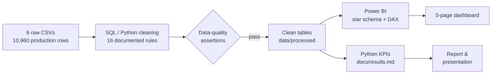
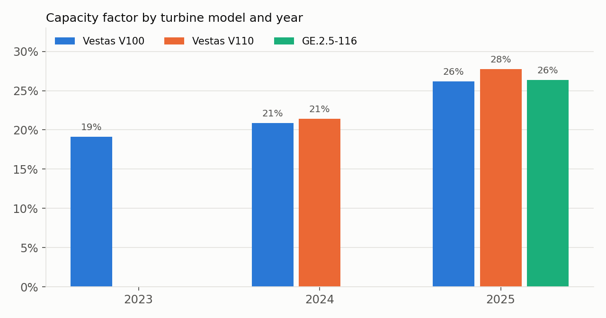
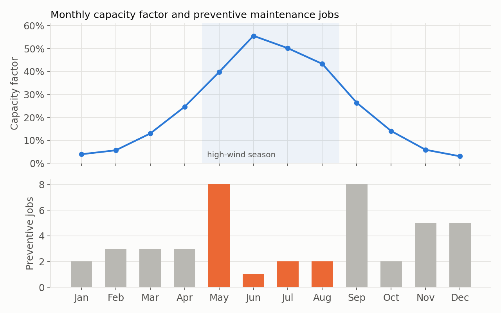

# Aerowind: Wind Farm Performance & Reliability Analytics

[](https://github.com/diamedego/aerowind-wind-farm-analytics/actions/workflows/pipeline.yml)

End-to-end analytics project for "The Lighthouse", a 10-turbine, 21.9 MW wind farm in Necochea, Argentina (2023-2025). The project covers cleaning raw CSVs with SQL/Python and automated data-quality checks, building a Power BI star-schema model, and a KPI-driven analysis of energy performance, reliability, wind resource and profitability.

> **Note on the data:** Aerowind and its wind farm are fictional. The dataset is synthetic: it was generated with AI and includes realistic data-quality problems, for the capstone project of the Data Analytics bootcamp at Unicorn Academy. Turbine models and power curves are based on public specifications.

**Stack:** MySQL · Python (pandas) · Power BI (DAX, star schema) · matplotlib

---

## Business questions

- Is the energy performance consistent with the installed capacity, and is 2025 a new baseline?
- Did the new turbine models (Vestas V110, GE 2.5-116) improve the farm?
- Where does the maintenance budget go, and which turbines drive reliability problems?
- How does the wind resource explain generation?
- What drives profit growth, and how seasonal is it?

## Key findings

| Area | Finding |
|---|---|
| Energy performance | Generation grew from 16.5 GWh (2023) to 48.2 GWh (2025) as the fleet expanded from 5 to 10 turbines. The capacity factor rose from 19.1% to 26.6%, above the 25% target in 2025, with availability stable at around 89%. |
| Technology | The 2025 capacity-factor increase happened in every turbine model (V100 26.2%, V110 27.7%, GE 2.5-116 26.4%), with a stable wind resource (6.3 m/s). The newer models stand out in reliability: 93-94% availability versus 87% for the V100 units, and fewer corrective events in their first year (0.7 per GE turbine versus 4.2 per V100). |
| Critical asset | T003 has the lowest capacity factor (19.9%) and availability (83%), the most corrective events (5 per year) and the highest maintenance cost (USD 42.7k, 22% of the total). Overtemperature is its main failure mode (5 of 15), and it delivers about 6% less power than the other V100 units at the same wind speed. |
| Maintenance | Cost does not scale with the number of interventions: 2025 had 45 events (28 preventive) for USD 57k, versus 35 events for USD 75k in 2024. A corrective job costs USD 2,858 on average versus USD 432 for a preventive one. Across turbines, higher maintenance cost goes with lower availability (r = -0.87). |
| Wind resource | 59% of the energy is produced on days with a mean wind of 6-10 m/s. In 2025, real power moved closer to the theoretical curve above 8 m/s. |
| Profitability | Profit (revenue minus maintenance cost) grew from USD 0.95M in 2023 to USD 1.54M in 2024 and USD 2.88M in 2025, driven almost entirely by revenue. It follows the wind season, and January 2023 is the only month with a negative result. |

## Recommendations

1. **Preventive-predictive maintenance for the V100 fleet, starting with T003:** thermal management for the overtemperature shutdowns, temperature and vibration monitoring, and an evaluation of a retrofit.
2. **Prioritize the GE 2.5-116 for future expansions** (higher availability, lower maintenance cost), and confirm it as more years of operation become available.
3. **Schedule planned maintenance in the low-wind months (November-February).** Today 30% of preventive jobs fall in May-August, the high-wind season.
4. **Use T008-T010 as the internal benchmark** for operating and maintenance practices.

---

## Pipeline



- **Cleaning:** [`sql/aerowind_cleaning.sql`](sql/aerowind_cleaning.sql) (MySQL) and [`python/clean.py`](python/clean.py), the tested reference implementation of the same rules. The clean tables are written in the format the Power BI model reads, so a refresh picks them up directly.
- **Data-quality log:** [`docs/data_quality_log.md`](docs/data_quality_log.md) lists every issue with its detection rule, rows affected, decision and rationale.
- **KPIs:** [`python/analyze.py`](python/analyze.py) computes every number in this README (same definitions as the DAX measures) into [`docs/results.md`](docs/results.md).
- **Dashboard:** [`dashboard/aerowind_dashboard.pbix`](dashboard/aerowind_dashboard.pbix)
- **Report and presentation:** [`docs/Aerowind_Descriptive_Report.docx`](docs/Aerowind_Descriptive_Report.docx) · [`docs/Aerowind_Presentation.pptx`](docs/Aerowind_Presentation.pptx)

## Data quality

The raw data contains realistic quality problems. Each one is handled by a documented rule:

- **Split production records:** three turbines had 3-4 records per day. The hours were split across the records, while each record repeated the full-day energy. Hours are therefore summed and energy is averaged, which was validated against the same-model turbines on the same day.
- **Physical limits:** turbine-days above nominal power × 24 h, production before the installation date, and days whose hours do not add up to 24 h are removed.
- **Weather:** invalid temperature, humidity and pressure values are set to null without dropping the day, so the wind data is kept.
- **Prices:** two invalid monthly prices are imputed from the same month of the following year, because the tariff profile repeats every year.

The full list of 16 rules is in the [data-quality log](docs/data_quality_log.md).

## Analysis





### Park KPIs

| Year | Turbines | Energy (GWh) | Capacity factor | Availability | Performance | Revenue (USD) | Maintenance (USD) | Profit (USD) |
|---|---|---|---|---|---|---|---|---|
| 2023 | 5 | 16.5 | 19.1% | 89.0% | 63.8% | 1,016,169 | 64,168 | 952,002 |
| 2024 | 7 | 26.4 | 21.0% | 88.7% | 64.1% | 1,617,905 | 74,868 | 1,543,037 |
| 2025 | 10 | 48.2 | 26.6% | 89.7% | 66.6% | 2,939,697 | 57,186 | 2,882,511 |

The turbine scorecard, failure Pareto and monthly figures are in [`docs/results.md`](docs/results.md).

### KPI definitions

| KPI | Definition |
|---|---|
| Capacity factor | Σ energy / Σ (nominal power × 24 h), over the days each turbine was in operation |
| Availability | operating h / (operating h + inactive h) |
| Performance | 0.65 × availability + 0.30 × capacity factor + 0.05 × 1 / (1 + corrective events) |
| Revenue | energy × monthly price (USD/kWh) |
| Profit | revenue − maintenance cost |

## Dashboard

Five pages: Energy Performance · Wind Resource · Operational Reliability · Profitability · Turbine Monitoring.

<!-- Screenshots: dashboard/screenshots/ -->

## Data model

A constellation (multi-fact star) schema, with relationships defined in Power BI:

- **Facts:** `production` (turbine-day) and `maintenance` (job)
- **Dimensions:** `turbines`, `weather` (day), `price` (month), `calendar`
- **Reference:** `theoretical curves` (power curve per model)

## Run it

```bash
python3 -m venv .venv && source .venv/bin/activate
pip install -r python/requirements.txt
python python/clean.py      # raw -> processed + data-quality report (fails on any violated rule)
python python/analyze.py    # KPIs -> docs/results.md, charts -> images/
```

To use MySQL instead, run `sql/aerowind_cleaning.sql` after replacing `/path/to/repo`. In Power BI, point the data source to `data/processed/`.

## Repository structure

```
├── data/
│   ├── raw/                  # source CSVs as received
│   └── processed/            # clean tables (Power BI format) + data_quality_report.csv
├── sql/aerowind_cleaning.sql # MySQL cleaning & validation
├── python/
│   ├── clean.py              # cleaning pipeline + assertions
│   └── analyze.py            # KPIs, results.md and charts
├── dashboard/                # Power BI file + screenshots
├── docs/
│   ├── Aerowind_Descriptive_Report.docx
│   ├── Aerowind_Presentation.pptx
│   ├── data_quality_log.md
│   └── results.md            # generated
└── images/                   # generated charts
```

## Limitations

- The data is synthetic, so the patterns illustrate the method rather than a real farm.
- The data is daily. A real power-curve analysis needs 10-minute SCADA data; comparing the daily mean wind with the curve is approximate.
- Availability is time-based, not energy-based.
- Maintenance is the only cost in the data, so profit here means revenue minus maintenance cost.

---

**Diamela Dego:** Chemical Engineer · Continuous Improvement · Data Analytics
[LinkedIn](https://www.linkedin.com/in/diamela-dego) · [GitHub](https://github.com/diamedego)
